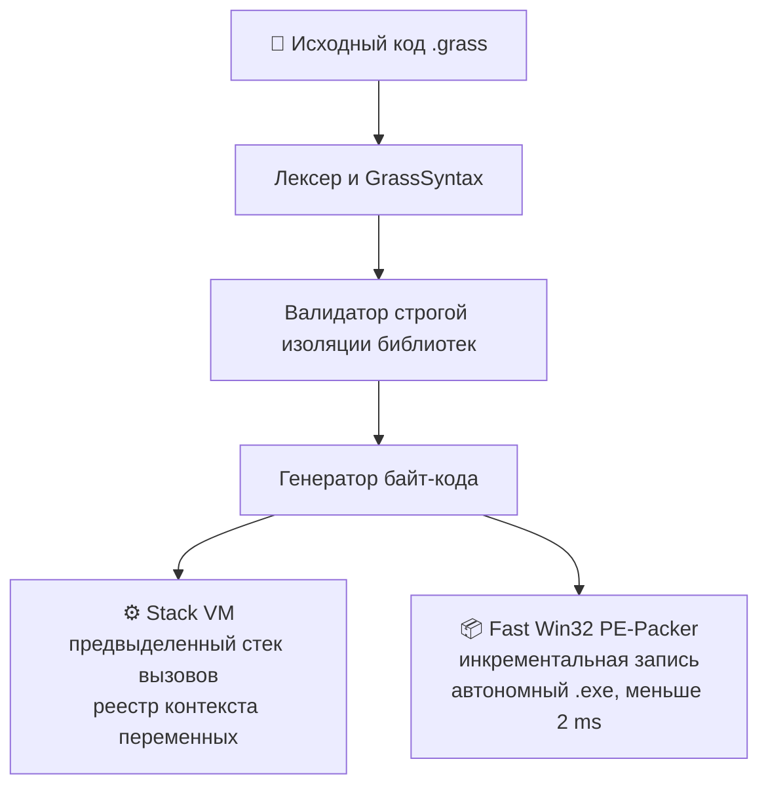

<div align="center">


# 🌿 GrassGreen

### Высокопроизводительный стек-ориентированный язык системного уровня
**C++-синтаксис · собственная Stack VM · сборка в автономный Win32 `.exe`**

<sub><i>High-performance bytecode programming language with C++ syntax, stack VM, PE .exe packer, and built-in GUI engine.</i></sub>

<br>

[](https://isocpp.org/)
[](https://microsoft.com)
[](#-архитектура)
[](https://github.com/m1oky/GrassGreen)
[](LICENSE)

<br>

[**🚀 Быстрый старт**](#-быстрый-старт) &nbsp;·&nbsp; [**🧱 Архитектура**](#-архитектура) &nbsp;·&nbsp; [**📊 Бенчмарки**](#-бенчмарки) &nbsp;·&nbsp; [**🧩 Модули**](#-модули) &nbsp;·&nbsp; [**🔨 Сборка**](#-сборка-из-исходников) &nbsp;·&nbsp; [**💻 CLI**](#-команды-cli)

</div>

---

**GrassGreen** — независимый компилируемый язык программирования. В комплекте: собственная виртуальная машина (Stack VM) с прямой диспетчеризацией опкодов, инкрементальный PE-Packer для генерации автономных `.exe`, модульный GUI-движок на базе Win32/GDI+, сетевой стек, парсер JSON, управление процессами, файловая система, мониторинг ОС и буфера обмена, встроенный reactive-web сервер и инструменты прямого управления памятью.

## ✨ Возможности

| | | |
| :--- | :--- | :--- |
| ⚡ **Быстрая Stack VM**<br><sub>Прямая диспетчеризация опкодов, предвыделенный стек вызовов</sub> | 📦 **Автономные `.exe`**<br><sub>Инкрементальный PE-Packer, сборка за ~1.45 ms</sub> | 🪟 **GUI-движок**<br><sub>Win32 / GDI+, скругления, ClearType, без мерцания</sub> |
| 🌐 **Сетевой стек**<br><sub>`!GrassNet!`: TCP/IP, HTTP/HTTPS, сокет-сервер</sub> | 🗄️ **Встроенная БД**<br><sub>`!database!`: Key-Value движок GSE с шифрованием</sub> | 🕸️ **Web-раннер**<br><sub>`!GrassWeb!`: `.grass` DSL → HTML5/CSS3/ES6</sub> |
| 🧾 **JSON без библиотек**<br><sub>`!json!`: парсинг, сборка, валидация</sub> | 🖥️ **Системный доступ**<br><sub>`!sys!`, `!proc!`, `!fsys!`, `!memory!`</sub> | 🧪 **Математика**<br><sub>`!FastMath!` и `!CoreMath!` (кубиты, GCD)</sub> |

---

## 🚀 Быстрый старт

**1. Разверни окружение VS Code** (иконки, подсветка, сниппеты, `Ctrl + Shift + B`):

```powershell
.\bin\grassc.exe install
```

**2. Создай `hello.grass`:**

```cpp
!GrassGreen!

int main() {
    cout << "Hello, GrassGreen!" << endl;
    return 0;
}
```

**3. Запусти или собери:**

```powershell
.\bin\grassc.exe ./! hello.grass     # выполнить в виртуальной машине
.\bin\grassc.exe .// hello.grass     # собрать автономный .exe
```

---

## 🧱 Архитектура

Компилятор `grassc` преобразует исходный текст в компактный двоичный поток инструкций с фиксированным шагом и связывает его с исполняемым ядром через оверлей PE-заголовка.



---

## 📊 Бенчмарки

Тест: 30 000 итераций арифметического сложения в цикле с проверкой граничных условий. CPU Intel Core i7, Windows 10 x64.

| Язык / среда | Время | Скорость |
| :--- | :---: | :--- |
| 🌿 **GrassGreen (Stack VM)** | **6.00 ms** | `█` &nbsp;**1.0x (baseline)** |
| NodeJS v20 (V8 JIT warmup) | 14.10 ms | `██` &nbsp;~2.3x медленнее |
| CPython 3.12 (standard) | 92.40 ms | `███████████████` &nbsp;~15.4x медленнее |

> 💡 Сборка в автономный `.exe` занимает **1.45 ms** благодаря инкрементальному обновлению PE-хвоста без полной перезаписи бинарника.

---

## 🧰 Строгая модульная система

Язык отвергает неявный импорт. Каждый вызов функций ядра проверяется на этапе трансляции синтаксического дерева. Точка входа обязана объявляться как `int main() { ... }`.

```text
!GrassGreen!    // Обязательный заголовок базового языка
!time!          // Точные таймеры
!GrassNet!      // Сетевой стек TCP/IP и HTTP
!json!          // Сериализация и парсинг JSON
!sys!           // Мониторинг Windows и буфер обмена
!proc!          // Управление процессами и инспекция памяти
!fsys!          // Расширенная файловая система и директории
```

---

## 🧩 Модули

14 встроенных модулей. Нажми на модуль, чтобы увидеть функции и пример.

| № | Модуль | Назначение |
| :-: | :--- | :--- |
| 1 | `!GrassGreen!` | Базовое ядро и управляющие конструкции |
| 2 | `!time!` | Профилирование и системные часы |
| 3 | `!interface!` | Win32/GDI+ Fluent GUI Engine |
| 4 | `!FastMath!` | Быстрая вычислительная математика |
| 5 | `!CoreMath!` | Квантовые вентили и криптопримитивы |
| 6 | `!memory!` | Мониторинг и управление ОЗУ |
| 7 | `!random!` | Генератор случайных величин |
| 8 | `!database!` | Key-Value движок GSE |
| 9 | `!GrassWeb!` | Реактивный Web-раннер |
| 10 | `!GrassNet!` | TCP/IP, HTTP/HTTPS, сокет-сервер |
| 11 | `!json!` | Парсинг и генерация JSON |
| 12 | `!sys!` | Мониторинг Windows, буфер обмена, железо |
| 13 | `!proc!` | Управление процессами |
| 14 | `!fsys!` | Файловая система и директории |

<details>
<summary><b>1. <code>!GrassGreen!</code> — базовое ядро и управляющие конструкции</b></summary>

<br>

Стандартная C++ семантика: типы `take`, `int`, `string`, потоки ввода-вывода `cout` / `cin`, циклы `for`, `while`, ветвления `if` / `else`.

```cpp
!GrassGreen!

int main() {
    take counter = 0;
    string title = "Kernel Initialized";

    for (take i = 0; i < 5; i++) {
        counter += i;
    }

    if (counter >= 10) {
        cout << title << ": " << counter << endl;
    }

    return 0;
}
```

</details>

<details>
<summary><b>2. <code>!time!</code> — аппаратное профилирование и системные часы</b></summary>

<br>

Высокоточное профилирование участков кода через счётчики `std::chrono::high_resolution_clock` и нативные системные вызовы Windows API.

| Функция | Что делает |
| :--- | :--- |
| `start_time()` | запуск высокоточного аппаратного секундомера |
| `stop_time()` | фиксация интервала, возврат миллисекунд (`double`) |
| `conclus_time()` | форматированный вывод затраченного времени строкой (`"7.42 ms"`) |
| `get_date()` / `get_time_str()` | локальная дата и время ОС |

```cpp
!GrassGreen!
!time!

int main() {
    start_time();

    take sum = 0;
    for (take i = 1; i <= 30000; i++) {
        sum = sum + i;
    }

    stop_time();

    cout << "Сумма: " << sum << " | Время: " << conclus_time() << endl;
    cout << "Метка времени: " << get_date() << " [" << get_time_str() << "]" << endl;
    return 0;
}
```

</details>

<details>
<summary><b>3. <code>!interface!</code> — нативный Win32/GDI+ Fluent GUI Engine</b></summary>

<br>

Оконный движок с субклассированием оконных процедур, скруглением хитбоксов через `SetWindowRgn`, антиалиасингом ClearType и защитой от мерцания буфера (`WS_CLIPCHILDREN`).

```cpp
!GrassGreen!
!interface!

int main() {
    window {
        title("GrassGreen Engine Console");
        size(500, 420);
        color(#12131a);
        theme("dark");
        glass();

        label "Компилятор GrassGreen v3.6" {
            id(lbl_status);
            window-ob(0, 40);
            size(500, 32);
            middle();
            text-color(#00ffcc);
            font-size(20);
            font-style("Segoe UI");
            shadow();
        }

        enter "Ввод команды..." {
            id(cmd_input);
            window-ob(50, 100);
            size(400, 40);
            middle();
            radius(8);
        }

        button "Выполнить операцию" {
            id(btn_exec);
            window-ob(50, 160);
            size(400, 44);
            middle();
            button-color(#1a2634);
            text-color(#00ffcc);
            radius(10);
            shadow();
            click-ob(cmd_input, lbl_status);
        }

        show();
    }
    return 0;
}
```

</details>

<details>
<summary><b>4. <code>!FastMath!</code> — оптимизированная вычислительная математика</b></summary>

<br>

Векторная и тригонометрическая математика без накладных расходов. Подходит для симуляций и графических расчётов.

| Функция | Что делает |
| :--- | :--- |
| `discor(x)` / `sqrt(x)` | быстрое вычисление квадратного корня |
| `lerp(a, b, t)` | линейная интерполяция между узлами |
| `clamp(val, min, max)` | ограничение диапазона скаляра |
| `sin(rad)`, `cos(rad)`, `abs(val)`, `round(val)`, `min(a, b)`, `max(a, b)` | базовые функции |

```cpp
!GrassGreen!
!FastMath!

int main() {
    take velocity = 144.0;
    take root = discor(velocity);
    take smoothed = lerp(0.0, 100.0, 0.75);

    cout << "Root: " << root << " | Lerp: " << smoothed << endl;
    return 0;
}
```

</details>

<details>
<summary><b>5. <code>!CoreMath!</code> — эмулятор квантовых вентилей и криптопримитивы</b></summary>

<br>

Программная эмуляция базовых унитарных преобразований кубитов и работа с криптографическими алгоритмами.

| Функция | Что делает |
| :--- | :--- |
| `qb_init(q)` | инициализация регистра состояния кубита в базисе \|0⟩ |
| `h(q)` | оператор Адамара (квантовая суперпозиция) |
| `x(q)` | вентиль Паули-X (квантовое отрицание NOT) |
| `cnot(ctrl, target)` | двухкубитовый контролируемый вентиль отрицания |
| `q_rand(q)` | редукция суперпозиции и измерение бита (0 или 1) |
| `gcd(a, b)` | алгоритм Евклида, наибольший общий делитель |

```cpp
!GrassGreen!
!CoreMath!

int main() {
    qb_init("q0");
    h("q0");
    take measured_bit = q_rand("q0");

    cout << "Квантовое случайное состояние: " << measured_bit << endl;
    return 0;
}
```

</details>

<details>
<summary><b>6. <code>!memory!</code> — прямой мониторинг и управление ОЗУ</b></summary>

<br>

Низкоуровневый контроль кучи, ручное выделение блоков памяти и защита от утечек.

| Функция | Что делает |
| :--- | :--- |
| `memory_usit()` | текущее потребление памяти виртуальной машиной в байтах |
| `memory_free()` | объём физически свободной оперативной памяти в системе |
| `memory_alloc(bytes)` | резервирование дескриптора блока памяти |
| `memory_free_block(id)` | явное освобождение выделенного сегмента |
| `memory_limit(bytes)` | барьер ВМ (аварийный останов при переполнении) |
| `memory_clean()` | сборка неиспользуемых строковых литералов |

```cpp
!GrassGreen!
!memory!

int main() {
    memory_limit(67108864); // Барьер в 64 МБ

    take block = memory_alloc(1048576);
    cout << "Выделен блок ID: " << block << endl;
    cout << "Использовано ядром: " << memory_usit() << " байт" << endl;

    memory_free_block(block);
    memory_clean();
    return 0;
}
```

</details>

<details>
<summary><b>7. <code>!random!</code> — генератор случайных величин</b></summary>

<br>

Генератор на основе `std::mt19937` с поддержкой случайных строковых токенов разного регистра.

```cpp
!GrassGreen!
!random!

int main() {
    take roll = random(1, 100);
    string token = random_txt("en", 16);

    cout << "Случайный диапазон [1-100]: " << roll << endl;
    cout << "Токен сессии: " << token << endl;
    return 0;
}
```

</details>

<details>
<summary><b>8. <code>!database!</code> — встраиваемый Key-Value движок GSE</b></summary>

<br>

Собственный бинарный движок хранения данных **Grass Storage Engine**:

- многотабличные пространства (`table("users")`);
- атомарный инкремент и декремент числовых ключей без блокировки потока (`db_inc`);
- 64-битное хеширование ключей по алгоритму FNV-1a (`db_hash`);
- симметричное блочное XOR-шифрование с солью (`db_encrypt` / `db_decrypt`);
- экспорт в JSON и инкрементальный бэкап.

```cpp
!GrassGreen!
!database!

int main() {
    db_open("storage.gdb");
    table("session_tokens");

    db_set("admin_key", "sec_token_9918");
    db_encrypt("admin_key", "SaltPhrase");

    take visits = db_inc("visits_total", 1);
    db_save();

    cout << "Записей в таблице: " << visits << endl;
    return 0;
}
```

</details>

<details>
<summary><b>9. <code>!GrassWeb!</code> — реактивный лёгкий Web-раннер</b></summary>

<br>

Встроенный HTTP-сервер на сокетах WinSock2. Транслирует компактный `.grass` DSL прямо в чистый HTML5/CSS3/ES6 без тяжёлых зависимостей (React/Vue/Webpack) и отдаёт страницы клиенту за 1–3 ms.

```text
!GREEN_WWW1!
!GrassWeb!

glass(16, 0.08)
neon(#00ffcc)
box-start
    icon(bolt)
    color(#00ffcc)
    thick()
    G5 GrassGreen Edge Platform

    <name>/status_lbl
    color(#8e99a8)
    G2 Шлюз запущен на localhost:8080

    row-start
        <name>/btn_ping
        grad(#00ffcc, #0088ff)
        round-ob(8)
        button = Проверить статус ядра
    row-end
box-end

script-start
    on-click(btn_ping)
        set-text(status_lbl, Система в норме: задержка 0.4 ms)
        repaint-color(status_lbl, #00ff88)
        play-anim(btn_ping, pulse, 0.2s)
    end-click
script-end
```

</details>

<details>
<summary><b>10. <code>!GrassNet!</code> — сетевой стек TCP/IP, HTTP/HTTPS клиент и сокет-сервер</b></summary>

<br>

Нативный сетевой модуль на базе **WinSock2** и **WinINet**. Поддерживает прямые литералы IPv4 без кавычек (`127.0.0.1`), декларативные блоки `agent` и `create_serv()` и фильтрацию входящих пакетов на уровне сокета.

| Функция | Что делает |
| :--- | :--- |
| `agent { browser "..."; device "..."; }` | заголовки `User-Agent` и системный профиль клиента для исходящих запросов |
| `API("token")` | автоматическая инъекция Bearer-токенов и `X-API-Key` в HTTP/HTTPS заголовки |
| `connect(host, [port])` | прямое TCP-соединение с контролем таймаута |
| `send(url, [method], [body])` | HTTP/HTTPS запросы с поддержкой TLS |
| `create_serv() { port: ...; IP: ...; password: ...; certainIP: ...; }` | неблокирующий TCP-сервер с привязкой к интерфейсу и белым списком `certainIP` |
| `accept()` / `async` | опрос дескрипторов через `select()` и синхронизация сетевых потоков |
| `ping(host)`, `resolve_ip(domain)`, `local_ip()`, `download(url, path)`, `net_status()`, `net_close()` | диагностические и транспортные примитивы |

```cpp
!GrassGreen!
!GrassNet!

int main() {
    cout << "Локальный интерфейс: " << local_ip() << endl;

    agent {
        browser "GrassGreenBot/3.6";
        device "Windows 10 x64; ProDesk";
    }

    API("gg_secret_api_token_2026");

    string target_ip = resolve_ip("example.com");
    if (connect("example.com", 80)) {
        cout << "Узел " << target_ip << " доступен | RTT: " << ping("example.com", 80) << " ms" << endl;
    }

    create_serv() {
        port: 8443;
        IP: 127.0.0.1;
        password: 1234;
        certainIP: 127.0.0.1;
    }

    async;
    cout << "Очередь сокета: " << accept() << endl;

    net_close();
    return 0;
}
```

</details>

<details>
<summary><b>11. <code>!json!</code> — сериализация, генерация и парсинг JSON</b></summary>

<br>

Лёгкий модуль парсинга и сборки JSON-пакетов для обмена данными с внешними Web API и сетевыми сервисами, без внешних библиотек.

| Функция | Что делает |
| :--- | :--- |
| `json_get(json_str, "key.subkey")` | рекурсивное извлечение значения поля или вложенного объекта |
| `json_set(json_str, key, value)` | создание ключа или обновление существующего в JSON-строке |
| `json_valid(json_str)` | валидация структуры JSON (баланс скобок и синтаксис) |
| `json_minify(json_str)` | сжатие JSON без незначимых пробелов и переводов строк |
| `json_clear()`, `json_add(k, v)`, `json_add_num(k, num)`, `json_build()` | потоковый билдер JSON-объектов |

```cpp
!GrassGreen!
!json!

int main() {
    // Построение JSON документа
    json_clear();
    json_add("project", "GrassGreen");
    json_add("author", "m1oky");
    json_add_num("version", 3.6);

    string payload = json_build();
    cout << "JSON Payload: " << payload << endl;

    // Чтение значений по ключу
    string author = json_get(payload, "author");
    cout << "Разработчик: " << author << " | Валидность: " << json_valid(payload) << endl;

    // Обновление структуры
    string updated = json_set(payload, "status", "production");
    cout << "Обновлено: " << updated << endl;
    return 0;
}
```

</details>

<details>
<summary><b>12. <code>!sys!</code> — системный мониторинг Windows, буфер обмена и железо</b></summary>

<br>

Прямое взаимодействие с подсистемами Windows через Win32 API: диагностика железа, системные метрики и буфер обмена.

| Функция | Что делает |
| :--- | :--- |
| `clip_set(text)` | копирование строки в глобальный буфер обмена (`Ctrl + C`) |
| `clip_get()` | чтение буфера обмена (`Ctrl + V`) |
| `screen_w()` / `screen_h()` | физическое разрешение основного дисплея в пикселях |
| `pc_name()` / `user_name()` | сетевое имя ПК и учётная запись пользователя |
| `cpu_cores()` | количество активных логических потоков процессора |
| `ram_total_mb()` / `ram_free_mb()` | общий и свободный объём физической памяти |
| `uptime_sec()` | время непрерывной работы Windows в секундах |
| `get_env(var_name)` | значение системной переменной окружения (`"PATH"`, `"TEMP"`) |

```cpp
!GrassGreen!
!sys!

int main() {
    cout << "Узел: " << pc_name() << " | Пользователь: " << user_name() << endl;
    cout << "Дисплей: " << screen_w() << "x" << screen_h() << endl;
    cout << "Потоков CPU: " << cpu_cores() << endl;
    cout << "ОЗУ: свободно " << ram_free_mb() << " MB из " << ram_total_mb() << " MB" << endl;
    cout << "Аптайм Windows: " << uptime_sec() << " сек" << endl;

    // Работа с системным буфером обмена (Clipboard)
    clip_set("GrassGreen Engine 2026");
    cout << "Скопировано в буфер: " << clip_get() << endl;
    return 0;
}
```

</details>

<details>
<summary><b>13. <code>!proc!</code> — управление процессами и мониторинг памяти</b></summary>

<br>

Низкоуровневый аудит и контроль запущенных приложений Windows через Toolhelp32 и PSAPI. Подходит для фоновых мониторов, античит-сканеров и диспетчеров задач.

| Функция | Что делает |
| :--- | :--- |
| `proc_find(name)` | поиск процесса по имени файла (без учёта регистра), возвращает PID или `-1` |
| `proc_kill(pid)` | принудительное завершение через `TerminateProcess` (`1` или `0`) |
| `proc_mem(pid)` | занятая процессом память (Working Set) в мегабайтах |
| `proc_exists(pid)` | активен ли процесс с этим PID прямо сейчас (`1` или `0`) |
| `proc_list()` | список всех запущенных процессов и их PID строкой |

```cpp
!GrassGreen!
!proc!

int main() {
    take target = "explorer.exe";
    take pid = proc_find(target);

    cout << "Поиск процесса: " << target << " | PID: " << pid << endl;

    if (pid != -1) {
        take ram = proc_mem(pid);
        take is_active = proc_exists(pid);
        cout << "Статус активности (1 = живой): " << is_active << endl;
        cout << "Занято памяти: " << ram << " MB" << endl;
    } else {
        cout << "Процесс не найден!" << endl;
    }

    return 0;
}
```

</details>

<details>
<summary><b>14. <code>!fsys!</code> — расширенная файловая система и директории</b></summary>

<br>

Модуль для навигации, рекурсивного создания структуры директорий и инспекции файлов на базе `<filesystem>` из C++20.

| Функция | Что делает |
| :--- | :--- |
| `fs_mkdir(path)` | создание папки или цепочки вложенных директорий (`1` или `0`) |
| `fs_is_dir(path)` | проверка, что путь существует и это папка (`1` или `0`) |
| `fs_size(path)` | точный размер файла на диске в байтах |
| `fs_copy(src, dst)` | копирование файла с перезаписью существующего |
| `fs_list(path)` | текстовый листинг папки с отметками каталогов (`/`) |

```cpp
!GrassGreen!
!fsys!

int main() {
    take work_dir = "test_dir";
    take ok = fs_mkdir(work_dir);
    cout << "Создание папки '" << work_dir << "': " << ok << endl;

    take is_folder = fs_is_dir(work_dir);
    cout << "Проверка статуса папки (1 = да): " << is_folder << endl;

    take exe_size = fs_size("bin/grassc.exe");
    cout << "Размер бинарника grassc.exe: " << exe_size << " байт" << endl;

    cout << "Содержимое каталога bin:" << endl;
    take list_out = fs_list("bin");
    cout << list_out << endl;

    return 0;
}
```

</details>

---

## 🔨 Сборка из исходников

Нужен MinGW-w64 (GCC с поддержкой C++20):

```bash
g++ -std=c++20 -O3 -s \
  src/grassc.cpp \
  src/GrassSyntax.cpp \
  src/GrassProc.cpp \
  src/GrassFsys.cpp \
  src/GrassTime.cpp \
  src/GrassNet.cpp \
  src/GrassJson.cpp \
  src/GrassSys.cpp \
  src/gui_engine.cpp \
  src/GrassWeb.cpp \
  src/GSE.cpp \
  src/FastMath.cpp \
  src/CoreMath.cpp \
  src/GrassMemory.cpp \
  src/GrassRandom.cpp \
  -o bin/grassc.exe \
  -lgdiplus -lgdi32 -lcomctl32 -lwinmm -lws2_32 -lwininet -lurlmon -lpsapi
```

### Окружение VS Code

```powershell
.\bin\grassc.exe install
```

Команда автоматически:

1. Регистрирует векторные иконки для `.grass` (`logo.svg`) и баз данных `.gdb` (`gdb_logo.svg`).
2. Устанавливает TextMate-грамматику подсветки синтаксиса в расширения редактора.
3. Добавляет сниппеты для `int main()`, блоков `window { ... }`, `agent { ... }` и `create_serv()`.
4. Настраивает сборку открытого скрипта по **`Ctrl + Shift + B`**.

---

## 💻 Команды CLI

| Команда | Что делает |
| :--- | :--- |
| `grassc .// <файл.grass>` | компиляция скрипта в автономный исполняемый файл `.exe` |
| `grassc ./! <файл.grass>` | компиляция и мгновенное выполнение байт-кода во встроенной VM |
| `grassc install` | переустановка ассоциаций Windows, иконок и расширения VS Code |

---

## 🔭 Roadmap

<details>
<summary><b>Планируемые модули: <code>!tg!</code> и <code>!2DGraphics!</code></b></summary>

<br>

**`!tg!` — интеграция с Telegram API:** создание ботов и отправка сообщений.

| Функция | Что делает |
| :--- | :--- |
| `telegram_init(token)` | инициализация сессии с API-токеном |
| `send_message(chat_id, text)` | отправка текстового сообщения в чат |
| `get_updates()` | получение новых сообщений и событий |
| `send_photo(chat_id, photo_path)` | отправка изображения |
| `send_document(chat_id, document_path)` | отправка документа |

```cpp
!GrassGreen!
!tg!

int main() {
    telegram_init("YOUR_TELEGRAM_BOT_API_TOKEN");
    send_message(12345678, "Привет от GrassGreen!");
    send_photo(12345678, "path/to/image.jpg");
    send_document(12345678, "path/to/document.txt");
    return 0;
}
```

**`!2DGraphics!` — управление 2D-графикой:** линии, круги, прямоугольники и более сложные фигуры.

| Функция | Что делает |
| :--- | :--- |
| `create_canvas(width, height)` | создание холста |
| `draw_line(x1, y1, x2, y2)` | линия между двумя точками |
| `draw_circle(x, y, radius)` | круг |
| `draw_rectangle(x, y, width, height)` | прямоугольник |
| `fill_color(color)` | цвет заливки |
| `save_image(path)` | сохранение холста в файл |

```cpp
!GrassGreen!
!2DGraphics!

int main() {
    create_canvas(800, 600);
    fill_color("#00ffcc");
    draw_rectangle(100, 100, 200, 150);
    draw_circle(400, 300, 50);
    draw_line(100, 100, 700, 500);
    save_image("output.png");
    return 0;
}
```

</details>

---

## 📁 Структура проекта

```text
GrassGreen/
├── bin/
│   └── grassc.exe           # Компилятор, VM и упаковщик
├── docs/                    # Документация функций и сигнатур
│   ├── coremath.txt
│   ├── fastmath.txt
│   ├── fsys.txt
│   ├── gdb.txt
│   ├── GrassNet.txt
│   ├── interface.txt
│   ├── json.txt
│   ├── library.txt
│   ├── main.txt
│   ├── memory.txt
│   ├── proc.txt
│   ├── random.txt
│   ├── sys.txt
│   ├── time.txt
│   └── WEB.txt
├── examples/                # Эталонные тестовые сценарии
│   ├── benchmark.grass      # Стресс-тест циклов (30 000 итераций)
│   ├── config.gdb           # Бинарная конфигурационная база данных
│   ├── fsys_test.grass      # Файловая система и директории
│   ├── json_test.grass      # Парсинг и сборка JSON
│   ├── math.grass           # Комплексный тест CoreMath и FastMath
│   ├── memory.grass         # Граничные условия и лимиты кучи
│   ├── net_test.grass       # TCP/HTTP стек и сокет-сервер
│   ├── proc_test.grass      # Поиск процессов, память, завершение
│   ├── sys_test.grass       # Параметры железа и буфер обмена
│   ├── test_gui.grass       # Оконное приложение Fluent Win32
│   └── test_web.grass       # Реактивный веб-интерфейс на сокетах
├── src/                     # Исходный код C++
│   ├── CoreMath.cpp / .h    # Квантовый эмулятор кубитов
│   ├── FastMath.cpp / .h    # Тригонометрия и lerp
│   ├── GrassFsys.cpp / .h   # Расширенная файловая система
│   ├── GrassJson.cpp / .h   # Сериализация и парсер JSON
│   ├── GrassMemory.cpp / .h # Менеджер кучи и аллокатор блоков
│   ├── GrassNet.cpp / .h    # Сетевой стек WinSock2 / WinINet
│   ├── GrassProc.cpp / .h   # Управление процессами и память
│   ├── GrassRandom.cpp / .h # PRNG на базе mt19937
│   ├── GrassSyntax.cpp / .h # Лексер и генератор байт-кода
│   ├── GrassSys.cpp / .h    # Win32 мониторинг и буфер обмена
│   ├── GrassTime.cpp / .h   # Высокоточные часы
│   ├── GrassWeb.cpp / .h    # Встроенный HTTP-сервер
│   ├── GSE.cpp / .h         # Движок базы данных GSE
│   ├── gui_engine.cpp / .h  # Оконная подсистема Win32/GDI+
│   └── grassc.cpp           # Точка входа, Stack VM и PE-Packer
├── gdb_logo.svg             # Иконка хранилищ GSE (.gdb)
├── logo.svg                 # Иконка файлов GrassGreen (.grass)
├── LICENSE                  # MIT
└── README.md                # Этот файл
```

---

<div align="center">
  <sub>Разработано для высокопроизводительных компактных вычислений и системных утилит под Windows.</sub>
  <br><br>
  <b>🌿 GrassGreen v3.6.0</b> · MIT License
</div>
